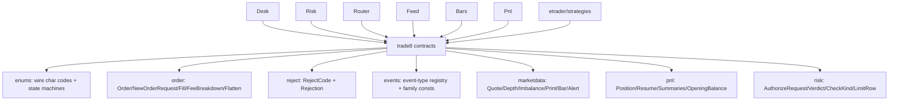

# README.md: trade8 contracts - Shared Domain Types

> Audience: consumers of the vertical's type vocabulary (services, apps,
> strategies). Wire-level construction in `DESIGN.md`; the vertical map in
> the top-level `DESIGN.md`.

## 1. Summary

`trade8::contracts` is the shared language of the trade8 vertical: the
wire-faithful enums, order/fill DTOs, the reject-code registry, the
event-type vocabulary, market-data shapes, P&L DTOs, and the Desk↔Risk
authorize contract. Every service and the app consume these types; the
event-name rules (colon-separated, four segments) are enforced here by
unit tests.

## 2. Motivation

Cross-service trading semantics drift painfully without one type source:
sides/STATES encoded differently per service, reject reasons as raw
strings, event names with dots. Contracts pins the vocabulary in one crate
with tests that (a) assert the colon-only event naming, (b) pin the wire
strings services encode, and (c) keep the state-machine legality table in
exactly one place.

## 3. Architecture & High-Level Design

## 4. Key Traits and Data Structures

- **`OrderState`** - the lifecycle enum with `can_transition` (the
  legality table: Pending→Accepted→Routed→PartiallyFilled→
  Filled/Cancelled/Replaced…); the engine-side authority.
- **`RejectCode`** - 31 stable reject reasons with `from_wire`,
  `registry_id`, `message`.
- **`events`** - the `trade8:{service}:{resource}:{operation}` registry
  (`order:submitted/accepted/rejected/cancelled/replaced/flatten/overnight…`,
  `router:fill:*`, `risk:limit:updated`, `feed:*`, `bars:*`, `pnl:*`) plus
  `FAMILY_*` stream-family constants.
- **DTO families** - order snapshots + fill/fee shapes; market-data
  envelopes (`QuoteUpdate…Bar` with ×10⁴ price fields); P&L shapes;
  the `AuthorizeRequest`/`AuthorizeVerdict` hot contract.

## 5. Rationale, Trade-offs, and Alternatives

- **Glob re-exports from `lib.rs`** - one flat surface for vertical
  consumers (`trade8::contracts::OrderState`); module paths remain for
  precision. Rejected: per-module re-export ceremony (import churn).
- **Wire strings as the enum serialization** - serde renames encode the
  exact wire values the legacy codecs expect, keeping FIX/OUCH adapters
  byte-true without translation layers.
- **State machine in the DTO crate** (not the engine): both Desk (enforcer)
  and any test/replay tooling need the same legality table.
- **Event-name tests in the crate** - the naming convention is enforced
  where the constants live, failing at test time rather than at transport.

## 6. Internal Implementation & Invariants (Private Design)

- Event-type constants are `pub const &str` built exactly once in
  `events.rs`; unit tests assert the colon-naming and uniqueness.
- `RejectCode` ids are stable integers (registry key) - never reorder.
- All price/qty fields are `i128`/`u64` raws + explicit scale (×10⁴
  money, instrument ticks); no floats anywhere in the crate.
- `serde` renames pin every wire string; changing one is a vertical
  wire-contract change.

## 7. Unresolved Questions / Future Designs

- Dead event constants (`catalog:updated`, `borrow:reserved/released/
  adjusted`, `risk:restriction:updated`, `desk:order:batch-requested`) are
  declared but unemitted - prune or wire them (see service design docs).
- Feed-type vocabulary breadth (venue feeds beyond the current set) may
  grow `FeedType` variants - additive only.

# DESIGN.md highlights

The crate is a leaf library: no runtime, no tables, no endpoints. Deep
detail lives inline; the vertical-level contracts (event envelope, naming,
×10⁴ scale) are specified in
the top-level `DESIGN.md` §4 (events) and
`design/sentin8-trade8-data-model-technical-design.md`. Notable tests:
event-naming law, state-machine legality matrix, reject registry ids.

## Testing

18 unit tests: enums wire round-trips, order math/notional, reject
registry, events naming law, marketdata bar folds, pnl folds, risk
verdicts.

# BUSINESS.md highlights

**Business value**: one trade language for six services + the app - the
reason order terms, reject reasons, P&L numbers, and event names agree
everywhere the platform. Consumers: all trade8 services, strategies, and
the etrader app DTO layer.

---

**Design attribution:** trade8:contracts and its underlying concepts were designed by Hamid Jahanzad <Hamid@Jahanzad.com>.
