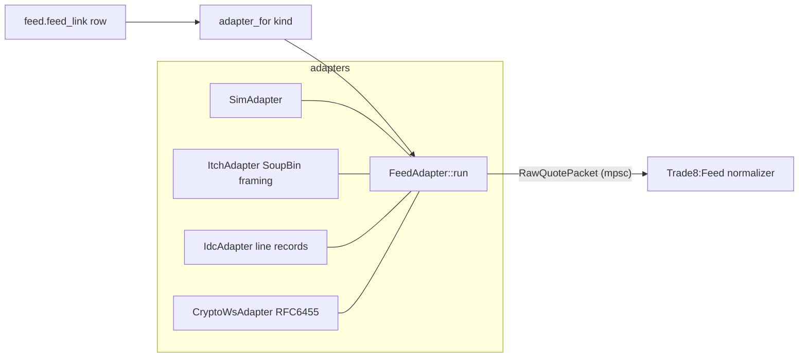

# README.md: trade8 feed-adapters - Vendor Feed Adapter Crate

> Audience: consumers (Trade8:Feed) and vendor-adapter authors.
> `DESIGN.md`-level detail lives inline in `src/lib.rs`; the engine-facing
> contract is in `../feed/DESIGN.md` §1/§2.

## 1. Summary

Pluggable vendor-feed parsers for Trade8:Feed: one `FeedAdapter` trait,
implementations for ITCH-style binary listeners, IDC-format feeds, crypto
WebSocket books, and a deterministic sim/replay adapter. Adapters parse
vendor packets into vendor-agnostic `RawQuotePacket`s; the service's
normalizer turns those into the internal event shapes.

## 2. Motivation

Vendor connectivity is the classic integration tar pit: every vendor has a
different framing, sequence model, and credential story. Isolating that
behind one trait keeps Trade8:Feed's engine vendor-free and gives testing a
deterministic replay adapter instead of live vendor sessions.

## 3. Architecture & High-Level Design

## 4. Key Traits and Data Structures

- **`trait FeedAdapter`** - `kind()` + `run(config, credentials, tx)` (the
  dyn-compatible boundary the supervisor drives).
- **`AdapterKind`** (`Itch | Idc | FixMd | CryptoWs | Sim`) + `adapter_for`
  registry.
- **`RawQuotePacket`** `{source_id, seq, bytes}` - the vendor-agnostic
  envelope; **`RawRecord`** (`Bbo/Level/Print/Imbalance`) + `parse_itch_record`
  - the internal normalized parse.
- **`FeedLinkConfig`** - link row shape with `credentials_ref` (secret ref).
- **`SymbolDirectory`** - vendor symbol → (symbol_id, price_scale) mapping.

## 5. Rationale, Trade-offs, and Alternatives

- **dyn-compatible trait + registry**, not generics: adapter selection is
  runtime configuration (link rows), not compile-time.
- **Bounded channel** `RawSender` - slow normalizer applies backpressure at
  the adapter, protecting memory in bursts.
- **Parse, don't interpret**: adapters emit raw records; business
  normalization (consolidation, alerts) stays in the service engine.
- **Rejected**: per-vendor daemons (deployment sprawl), generic "config
  DSL" adapters (unsafe parsing surface).

## 6. Internal Implementation & Invariants (Private Design)

- The Sim adapter replays scripted hex frames deterministically (same
  script ⇒ same packets) - the unit-test foundation for the whole feed path.
- ITCH framing accepts SoupTCP-style length prefixes with gap tracking;
  IDC records are line-delimited; the WS client hand-rolls RFC 6455
  (masked text frames only) with bounds-checked reads - decode errors are
  typed `AdapterError`s, never panics.
- `FixMd` maps to the sim adapter until the FIX market-data client lands.

## 7. Unresolved Questions / Future Designs

- FIX-MD adapter production impl; MoldUDP ingress if a venue requires it;
  symbol-directory auto-discovery from vendor feeds.

## Testing

7 unit tests: sim replay determinism, ITCH parse paths, IDC records, WS
framing, registry mapping.

---

**Design attribution:** trade8:feed-adapters and its underlying concepts were designed by Hamid Jahanzad <Hamid@Jahanzad.com>.
