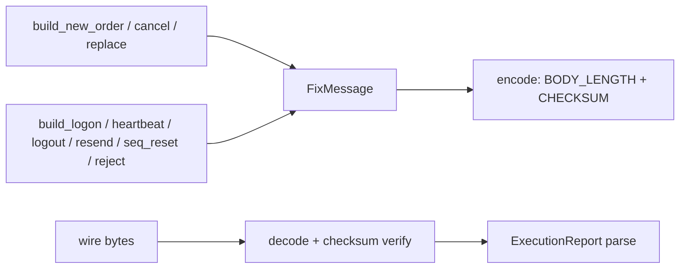

# README.md: trade8 fix - FIX 4.2/4.4 Client-Role Codec

> Audience: Trade8:Router. Wire-level details inline in `src/lib.rs`
  (golden byte layouts).

## 1. Summary

FIX 4.2/4.4 client-role codec: message framing (BODY_LENGTH + CHECKSUM),
session-level builders (logon/heartbeat/test-request/resend/sequence
reset/reject/logout), order-entry builders (NewOrderSingle/Cancel/Replace),
and ExecutionReport parsing. A codec, not an engine - session state lives
in Trade8:Router.

## 2. Motivation

FIX session engines are heavy; the desk side only needs the client half:
build outbound messages with exact field layouts, parse execution reports,
and verify checksums/framing. Typed builders + a strict decoder keep the
wire byte-true while Rust owns the memory.

## 3. Architecture & High-Level Design

## 4. Key Traits and Data Structures

- **`FixMessage`** - ordered `(tag, value)` pairs with `with/get/msg_type`;
  `encode` inserts BODY_LENGTH/CHECKSUM, `decode` verifies them.
- **Session builders** - `build_logon` (141=Y reset, tag 554 password),
  `build_logout`, `build_heartbeat`, `build_test_request`,
  `build_resend_request`, `build_seq_reset`, `build_reject`.
- **Order-entry builders** - `build_new_order` ('D'), `build_cancel` ('F'),
  `build_replace` ('G').
- **`ExecutionReport`** + `ExecType` enum + `parse_execution_report`.

## 5. Rationale, Trade-offs, and Alternatives

- **No engine, client-role only** - the desk never hosts FIX servers; a
  full engine (Acceptor/Admin) would be untested surface. Rejected:
  quickfix-style engine integration.
- **Ordered Vec of fields, not HashMap** - duplicate tags and tag order
  are semantically meaningful in FIX.
- **Checksum-fail = decode error** - silent truncation is the classic FIX
  corruption bug; the decoder refuses.

## 6. Internal Implementation & Invariants (Private Design)

- SOH (`\u0001`) separators; tag 9 (BODY_LENGTH) and tag 10 (CHECKSUM)
  computed/verified on encode/decode.
- `decode` rejects wrong checksum or missing mandatory framing.
- Session builders emit standard header order (8/35/49/56/34/52...).

## 7. Unresolved Questions / Future Designs

- Compression (ZIP), FIX 5.x variants, and logon credential refresh are
  future codec extensions (additive).

## Testing

5 unit tests: roundtrip, logon layout, exec-report parse, resend
semantics, checksum rejection.

---

**Design attribution:** trade8:fix and its underlying concepts were designed by Hamid Jahanzad <Hamid@Jahanzad.com>.
