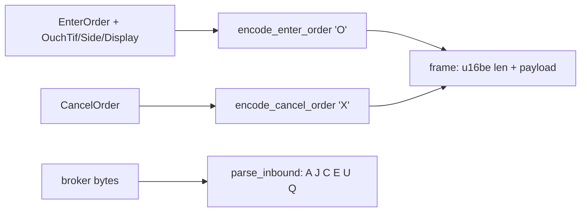

# README.md: trade8 ouch - OUCH 3.1 Client-Role Codec

> Audience: Trade8:Router. Golden byte layouts pinned in `src/lib.rs`.

## 1. Summary

OUCH 3.1 client-role codec: fixed-width Enter/Cancel order encoding,
length-prefixed framing, inbound message parsing
(Accepted/Rejected/Canceled/Executed/Replaced/CanceledByOther), and
time-in-force/side/display enums. Golden tests pin the exact byte layout.

## 2. Motivation

OUCH is a strict binary protocol: fixed-width, space-padded fields, one
byte message types. Hand-rolled per-integration encodings drift; this
crate pins the layout with tests so outbound frames are byte-true
regardless of destination broker quirks (dialect tags preserved upstream).

## 3. Architecture & High-Level Design

## 4. Key Traits and Data Structures

- **`EnterOrder` / `CancelOrder`** - the outbound structures with
  `encode_enter_order` / `encode_cancel_order` (block types 'O'/'X',
  fixed-width, space/zero padded per spec).
- **Enums** - `OuchTif` (O/I/K/M/P/X/T/D), `OuchSide` (B/S/S/T), 
  `OuchDisplay` (Y/N/P).
- **`OuchInbound`** - parsed inbound variants incl. `Executed` and
  `Replaced`.
- **Framing** - `frame` / `read_frame` / `write_frame` (u16be length
  prefix), `frame_enter_order` convenience.

## 5. Rationale, Trade-offs, and Alternatives

- **Struct + explicit encode** over a generic field-dsl: OUCH's strictness
  (fixed widths, exact field order) is easier to prove with pinned
  byte-layout tests than with reflective serialization.
- **Client role only** - no inbound order acceptance (a broker-facing
  server is out of scope).
- **u16be framing** per the 3.1 spec.

## 6. Internal Implementation & Invariants (Private Design)

- Field order/sizes follow the spec exactly: token[14], stock[8], firm[4];
  price is u64be at ×10⁴.
- Inbound parse is total over the 6 supported types; unknown types are
  errors, never misinterpreted.
- Space-padded strings zero-validated for binary-safety.

## 7. Unresolved Questions / Future Designs

- Replace-order (outbound 'U') encode is the remaining builder; dialect
  extension tags ride the tag-preservation layer in Router.

## Testing

5 unit tests with golden byte layouts (enter/cancel frames, inbound
parse, framing roundtrip).

---

**Design attribution:** trade8:ouch and its underlying concepts were designed by Hamid Jahanzad <Hamid@Jahanzad.com>.
