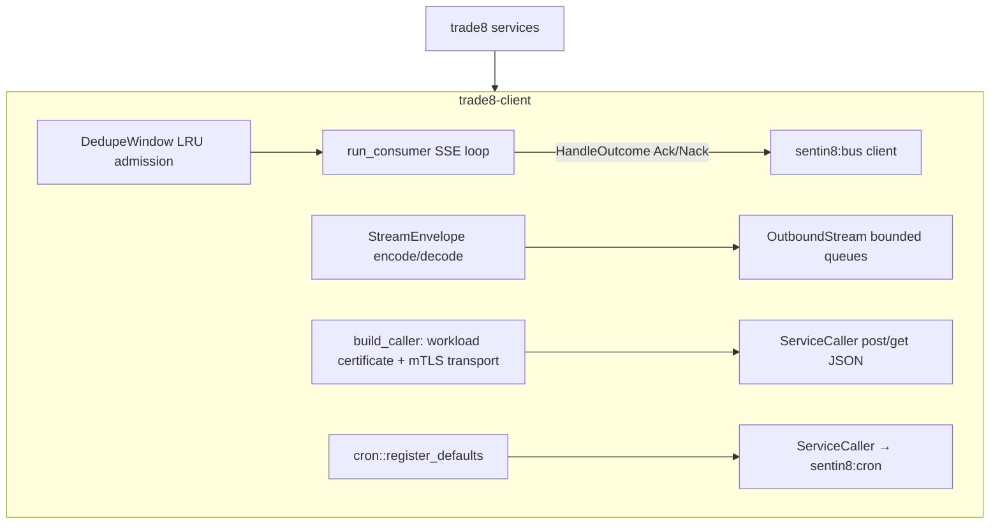

# trade8-client - Platform Client Crate (Bus/Service/Cron)

> Audience: trade8 services consuming the bus, calling sibling services,
> or registering schedules. Platform rules: `sentin8/design/sentin8-
> architecture-principles.md` §6.7/§6.8.

## 1. Summary

The vertical's client plumbing over the platform identity/bus planes:
`run_consumer` (SSE consume + ack/nack loop with dedupe-window semantics),
`build_caller` (certificate-presenting service caller - the caller's
workload certificate is the identity, CERTFREE-4V), `StreamEnvelope`/
`OutboundStream`/`DedupeWindow` (transport-agnostic event envelopes and
bounded fan-out), and `cron::register_defaults` (boot-time schedule
registration per service + proxy-back callback defaults).

## 2. Motivation

Every trade8 service needs the same four things: consume bus events with
exactly-once-ish semantics (ack/nack + idempotency), call sibling services
with the caller's workload certificate without hand-rolled OAuth, envelope stream
frames consistently, and register its Cron schedules at boot. Centralizing
this keeps services free of transport details and makes the ack/nack/DLQ
contract testable in one place.

## 3. Architecture & High-Level Design

## 4. Key Traits and Data Structures

- **`run_consumer(bus, stream_family, consumer_group, handler)`** - the SSE
  consume loop: blank-line-framed SSE events → handler → Ack or
  Nack(retry→DLQ)+ack-to-advance; reconnects at a 2s cadence.
- **`BusMessage`** - `{message_id, event_type, env_id, payload,
  correlation_id, idempotency_key}` with `payload_as::<T>`; `HandleOutcome`.
- **`StreamEnvelope`** - the same shape as a bus event, so consumers are
  transport-agnostic; `OutboundStream` per-kind monotonic seq + bounded
  `try_send` (`QueueFull` backpressure).
- **`DedupeWindow`** - bounded LRU idempotency-key admission.
- **`ServiceCaller`** (`service.rs`) - `build_caller(issuer, base_url,
  service_name)` mints-or-loads the CALLING service's workload
  certificate and wraps it in the mTLS transport (CERTFREE-4V - the TLS
  handshake IS the identity; the registry map authorizes the scopes)
  and exposes `post_json/get_json`; `SharedCaller` = Arc'd.
- **`cron`** - `BootSchedule` + `default_schedules(service_type, port)`
  (desk session choreography, bars EOD, router journal purge) +
  `register`/`register_defaults` (failures logged, not fatal).
- **`calls`** - the point-to-point contract constants
  (`trade8:risk:authorize:call/result`, `trade8:router:order:route/…ack`).

## 5. Rationale, Trade-offs, and Alternatives

- **SSE consume + ack/nack, not a persistent socket per consumer group:**
  the platform bus exposes SSE consumption; the loop centralizes framing,
  reconnect, and DLQ discipline. Rejected: ad-hoc per-service loops (the
  exact inconsistency this crate removes).
- **Certificate identity by default** (`build_caller`): the workload
  certificate presents in the TLS handshake - there is no bearer token to
  steal; the private key never leaves the workload's files.
- **Bounded queues + `QueueFull`** for frame fan-out: slow consumers
  backpressure instead of unbounded memory growth.
- **Boot-time Cron registration with dedupe (domain+name)** on the Cron
  side; failures log and continue so feeds/risk keep serving.

## 6. Internal Implementation & Invariants (Private Design)

- A Nack is always followed by an ack to advance the stream cursor; retry
  and DLQ are the bus's durability semantics - the client never spins on
  one message.
- The DedupeWindow admission is per window (bounded memory); consumers
  needing cross-restart dedupe persist keys in their domain store.
- Cron defaults are service-typed (`service_type` discriminates desk/bars/
  router schedules) and carry `target_config` for proxy-back URLs.
- All cross-service calls ride the platform mTLS transport built from the
  workload certificate (CERTFREE-4V); no plaintext key material passes
  through this crate and no token is ever fetched or attached.

## 7. Unresolved Questions / Future Designs

- Consumer redrive from DLQ (platform API) integration into `run_consumer`
  (manual replay currently goes through the bus DLQ endpoints).
- HTTP/2 multiplexing knobs on `ServiceCaller` (connection reuse today).

## Testing

7 unit tests: envelope roundtrip, queue backpressure, dedupe admission,
cron schedule shapes, caller construction.

---

**Architecture & Design:** trade8:trade8-client and its underlying concepts were designed by [Hamid Jahanzad](https://www.linkedin.com/in/hamidjahanzad/).
